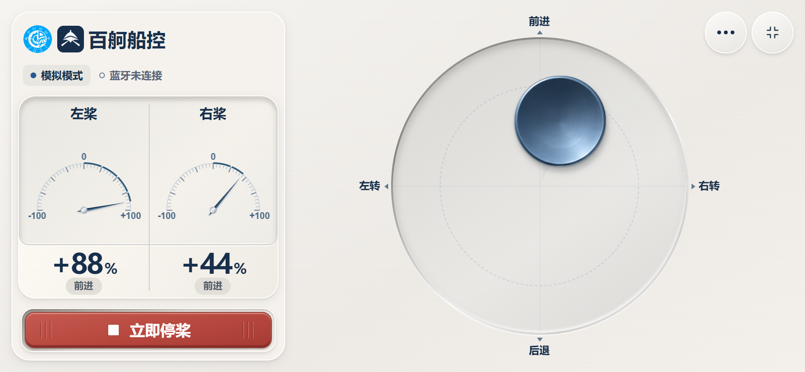

# 百舸船控

电子科技协会 2026 船模设计大赛的安卓遥控器与 51 单片机固件。手机通过 JDY-31 经典蓝牙串口控制双桨，STC89C52RC 通过软件 PWM 驱动 L298，实现前后调速、差速转弯和原地转向。

**[下载 v1.8.2 安卓安装包](https://github.com/zhaozhongyu094-afk/baige-boat-control/releases/download/v1.8.2/Baige-Boat-Control-v1.8.2.apk)** · [发布页](https://github.com/zhaozhongyu094-afk/baige-boat-control/releases/tag/v1.8.2) · [船控固件](dist/BoatPWM.hex) · [SHA-256 校验值](dist/SHA256SUMS)

「珍珠银」和「深蓝金属」共用嵌入式双桨表窗、微凹拇指碟和停桨键。在「设置 → 界面皮肤」可切换。深色皮肤以石墨灰区分面板与操控盘，浅钢蓝指针显示当前桨力。[深色竖屏](docs/screens/graphite-portrait.png) · [深色横屏](docs/screens/graphite-landscape.png) · [珍珠银竖屏](docs/screens/pearl-portrait.png)

首次打开即可离线模拟。竖屏点右上角齿轮打开设置，横屏点省略号选择蓝牙或设置，旁边的圆钮用于全屏。松手会立即清零控制指令，拇指碟约 130 毫秒回到圆心。

## 离线模拟与旧船

离线模拟支持横屏全屏。拖动拇指碟可观察两侧指令的方向和占比，点击「立即停桨」清零。原版 51 固件使用设置中的「旧版兼容模式」，默认发送前进、后退、左转、右转和停车五条指令。另可试用 4、8 或 12 Hz 的蓝牙点动调速。原版固件没有船端失联超时，断开后可能继续执行上一条指令。[兼容协议及测试](docs/protocol.md#v16-旧版兼容模式)

在电脑上体验时，下载仓库后用浏览器打开 `android/src/main/assets/index.html`，鼠标拖动摇杆即可模拟。

## 连接船模

1. 用 STC-ISP 将 `dist/BoatPWM.hex` 烧录到 STC89C52RC。固件按 **11.0592 MHz、12T** 配置，JDY-31 串口使用 **9600、8N1**。
2. 在 App 内点蓝牙按钮。列表显示所有已配对设备和系统搜索到的附近设备，按蓝牙地址合并。未命名设备也会列出，同名设备可用地址区分。列表为空时自动搜索一轮，已有设备时可点「搜索设备」手动刷新。任意名称的经典蓝牙串口模块都可尝试连接，标记「仅 BLE」的设备供查看。Android 12 及以上需要附近设备权限，旧版安卓搜索时需要定位权限。
3. 手机收到船端中位回执后进入就绪状态。首次联调先卸桨，检查正反转、左右转向、松手和断开连接后的停车表现。

P2.0、P2.1 接 L298 的 IN1、IN2 控制右桨，P2.2、P2.3 接 IN3、IN4 控制左桨。软件 PWM 约为 125 Hz，每侧正反各 32 个非零占空比。面板读数是下发的 PWM 指令。控制帧、回执、序号、CRC 和失联停车机制见 [通信协议](docs/protocol.md)。

## 构建

| 工程 | 环境与入口 |
|---|---|
| 安卓遥控器 | JDK 17、Gradle 8.13、Android SDK 36。仓库根目录运行 `gradle -p android assembleDebug`，生成的 APK 位于 `android/build/outputs/apk/debug/`。最低支持 Android 6.0。 |
| 51 船控固件 | 用 Keil µVision 和 C51 打开 `firmware/BoatPWM.uvproj`，重新构建后得到 `firmware/Objects/BoatPWM.hex`。 |

已检查安装包签名，使用包内页面验证了离线全屏、横竖屏切换、松手回中和停车。已在 8051 仿真器中核对 PWM 输出、通信回执和断流停车。手机与 JDY-31 实船链路、带桨起转和水上操控仍待实物联调。

界面使用的 Phosphor 图标及其授权说明见 [图标许可证](android/src/main/assets/icons/LICENSE.txt)。
