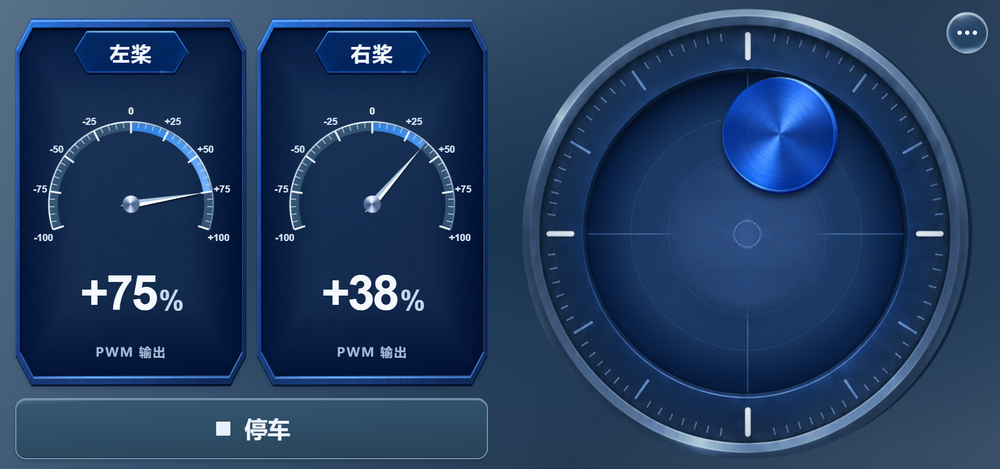

# 百舸船控 v1.5

电子科技协会 2026 船模设计大赛的安卓遥控器与 51 单片机固件。手机通过 JDY-31 经典蓝牙串口控制双桨，STC89C52RC 通过软件 PWM 驱动 L298，实现前后调速、差速转弯和原地转向。

**[安卓安装包](https://github.com/zhaozhongyu094-afk/baige-boat-control/releases/download/v1.5/Baige-Boat-Control-v1.5.apk)** · **[船控固件](dist/BoatPWM.hex)** · [校验值](dist/SHA256SUMS)

## 先体验遥控

安装 APK 后默认进入离线模拟，可以直接推杆、观察左右桨的 PWM 指令，松手后摇杆回中。点右上角进入横屏全屏，再轻触右上角圆钮即可展开「连接设备」和「退出全屏」。横竖屏工具栏采用液态玻璃样式，连接面板打开时背景渐渐模糊。双桨 PWM 仪表从中位向两端按 25% 分段，推力越高，冰蓝色弧段越亮。[竖屏界面](docs/screens/portrait.png) · [横屏界面](docs/screens/landscape.png) · [全屏工具栏](docs/screens/fullscreen-menu.png)

在电脑上体验时，下载仓库后用浏览器打开 `android/src/main/assets/index.html`，鼠标拖动摇杆即可模拟。

## 连接船模

1. 用 STC-ISP 将 `dist/BoatPWM.hex` 烧录到 STC89C52RC。固件按 **11.0592 MHz、12T** 配置，JDY-31 串口使用 **9600、8N1**。
2. 在 App 内点「连接设备」。面板优先列出已配对或本次使用中已经发现的 JDY-31-SPP；没有匹配项时自动搜索一轮，有设备时可点「搜索设备」手动查找。仅接受完整匹配的设备名，忽略大小写；同名设备按蓝牙地址区分。新模块点「配对并连接」，按安卓配对提示确认，随后 App 会连接所选模块。Android 12 及以上需要附近设备权限，旧版安卓搜索时需要定位权限。[连接面板](docs/screens/device-picker.png) 中的设备地址为测试示例。
3. 手机收到船端中位回执后进入就绪状态。首次联调先卸桨，检查正反转、左右转向、松手和断开连接后的停车表现。

P2.0、P2.1 接 L298 的 IN1、IN2 控制右桨，P2.2、P2.3 接 IN3、IN4 控制左桨。软件 PWM 约为 125 Hz，每侧正反各 32 个非零占空比。面板读数是下发的 PWM 指令。控制帧、回执、序号、CRC 和失联停车机制见 [通信协议](docs/protocol.md)。

## 构建

| 工程 | 环境与入口 |
|---|---|
| 安卓遥控器 | JDK 17、Gradle 8.13、Android SDK 36。仓库根目录运行 `gradle -p android assembleDebug`，生成的 APK 位于 `android/build/outputs/apk/debug/`。最低支持 Android 6.0。 |
| 51 船控固件 | 用 Keil µVision 和 C51 打开 `firmware/BoatPWM.uvproj`，重新构建后得到 `firmware/Objects/BoatPWM.hex`。 |

已检查安装包签名，使用包内页面验证了离线全屏、横竖屏切换、松手回中和停车。已在 8051 仿真器中核对 PWM 输出、通信回执和断流停车。手机与 JDY-31 实船链路、带桨起转和水上操控仍待实物联调。

界面使用的 Phosphor 图标及其授权说明见 [图标许可证](android/src/main/assets/icons/LICENSE.txt)。